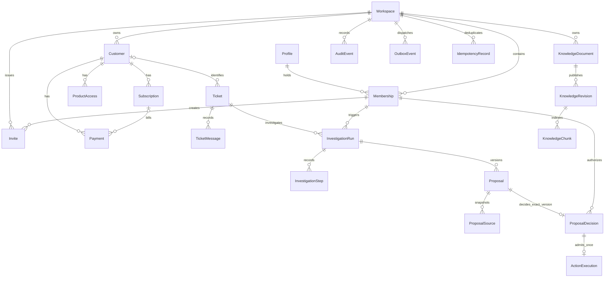

# Backend schema map

Updated **17 October 2026**: 22 business tables in private schema `handled`.
Prisma models and committed SQL migrations are authoritative for fields,
composite keys, checks, partial indexes and triggers.

| Domain                 | Tables                                                                          |
| ---------------------- | ------------------------------------------------------------------------------- |
| Identity               | Profile, Workspace, Membership, Invite                                          |
| Customer/account       | Customer, Subscription, Payment, ProductAccess                                  |
| Ticket                 | Ticket, TicketMessage                                                           |
| Investigation/proposal | InvestigationRun, InvestigationStep, Proposal, ProposalSource, ProposalDecision |
| Knowledge              | KnowledgeDocument, KnowledgeRevision, KnowledgeChunk                            |
| Operations             | AuditEvent, OutboxEvent, IdempotencyRecord, ActionExecution                     |

The diagram shows principal foreign-key relationships. Workspace ownership also
applies to every scoped table; those repeated edges are omitted for readability.
Ticket customer and payment subscription links are nullable. Composite keys bind
the workspace/customer/ticket/proposal version where the relation requires them.

`ProposalSource.sourceRefId`, `OutboxEvent.aggregateId`, `AuditEvent.entityId` and
`ActionExecution.targetId` are polymorphic references, not fictitious foreign keys
to every possible source/target. Services resolve them under trusted tenant and
business context. ActionExecution does have composite FKs to its exact proposal
version and decision, plus one-action-per-decision/proposal-version uniqueness.

Proposal/source/decision content, policy revision content, vector chunks and
successful action history have database immutability guards. Revision indexing
status may change; successful effects cannot be rewound through ordinary updates.
Knowledge vectors use `extensions.vector(768)`. Supabase `auth.users` and
`auth.sessions` are managed external identity tables, accessed through a private
reviewed identity function rather than owned by Prisma migrations.

Read the [core runbook](backend-core-setup.md) for extension placement, grants,
publication, jobs and recovery, and the [verification record](backend-core-verification.md)
for local evidence and live acceptance boundaries.
